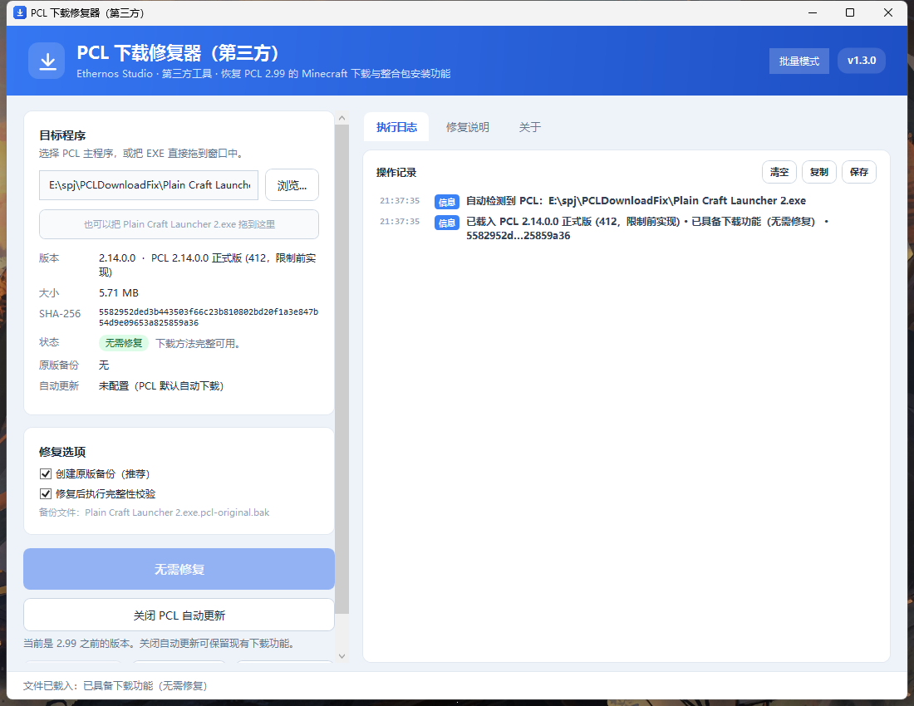
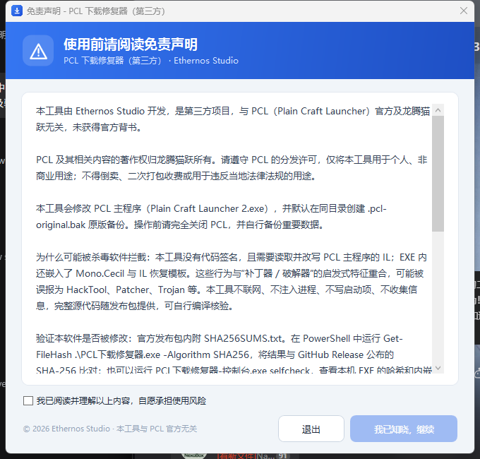
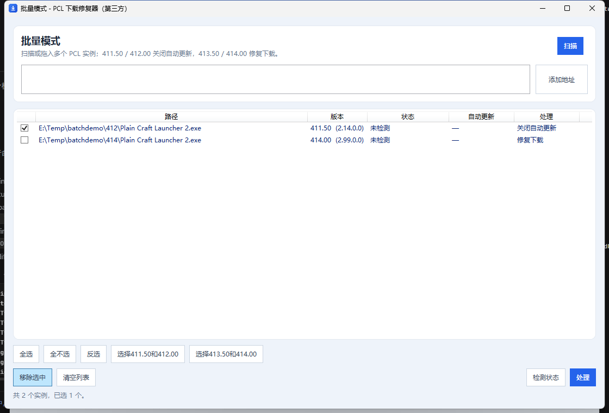

# PCL 下载修复器（第三方）

恢复 **PCL 2.99**（Plain Craft Launcher 2）被关闭的 Minecraft 下载与整合包安装功能，重点支持官方未单独适配的**快照版**构建。

[](https://github.com/Ethernos-Studio/PCLDownloadFix/actions/workflows/ci.yml)
[](https://github.com/Ethernos-Studio/PCLDownloadFix/releases)

> 本工具是第三方项目，与 PCL 官方及龙腾猫跃无关，未获得官方背书。PCL 及其相关内容的权利归原作者所有，请遵守 PCL 的分发许可，仅用于个人、非商业用途。



**开发者：** Ethernos Studio · **项目主页：** <https://github.com/Ethernos-Studio/PCLDownloadFix>

## 首次启动与免责声明

图形界面启动时会先显示免责声明窗口，必须勾选“我已阅读并理解以上内容”并点击“我已知晓，继续”才会进入主界面；关闭窗口或点击“退出”会直接结束程序。

控制台在执行 `patch`、`restore`、`verify`、`info`、`disable-update`、`enable-update` 前也会打印免责声明并要求输入 `Y` 确认。自动化环境请追加 `--yes`，否则程序会以退出码 `3` 结束，不会修改任何文件。

免责声明包含第三方声明、修改风险、杀毒软件误报原因、GitHub 地址和校验本程序完整性的方法。



## 背景

PCL 2.99 在源码中把 `ModSecret.RestrictMcDownload` 设为编译期常量 `True`，并替换了五个与下载相关的方法。由于 VB.NET 编译器会做常量折叠，正常的下载实现被直接从程序集中删除，表现为：

- 打开“下载”页面时提示：`为遵守相关法律法规，PCL 暂时不再提供 MC 下载功能，非常抱歉 qwq……`
- 版本列表无法加载，不能安装原版、Forge、Fabric、NeoForge、OptiFine 等
- “安装整合包”入口只弹提示，无法选择文件
- 资源详情页没有“安装”按钮
- 修改页隐藏“原版游戏”卡片

本工具不修改网络请求，也不伪造服务器响应，而是把限制提交前的五个官方方法体恢复回 EXE，并逐项校验。

## 功能

- **一键修复**：自动识别 PCL 2.99 正式版 (413)、快照版 (414) 及结构兼容的后续快照
- **停留在 2.99 之前**：对 412（2.14）等尚未升级的版本，可关闭 PCL 自动更新，避免被自动升级到 2.99，从而继续使用现有下载功能
- **批量模式**：独立窗口扫描、拖入或粘贴多个 PCL 实例，按内部构建号 `411.50/412.00` 关闭更新、`413.50/414.00` 修复下载
- **完整恢复**：不仅下载页，整合包安装、资源详情页安装按钮、修改页原版卡片一并恢复
- **更新后仍可修复**：PCL 自动更新会替换 EXE；工具会自动归档旧备份并继续修复，不再要求手动删除 `.bak`
- **安全备份**：修改前创建 `Plain Craft Launcher 2.exe.pcl-original.bak`，并写入 `.pclfix.json` 还原清单
- **严格校验**：只允许五个目标方法变化；其余方法必须逐字节语义一致；程序集身份与内嵌资源也必须保持不变；写入后重新读取再校验
- **原子替换**：先写临时文件，校验通过后才替换目标；保留原文件属性
- **一键还原**：按还原清单选择正确的备份，校验版本与哈希后再恢复
- **机器可读**：`--json` 在 stdout 输出单个 JSON 文档，进度与日志走 stderr，退出码稳定，便于脚本/启动器集成
- **可回归验证**：内置 xUnit 单元测试、CLI 契约测试与可选的真实 PCL 集成测试，GitHub Actions 自动构建
- **双形态**：图形界面 + 控制台，均支持命令行参数与自动化
- **完全离线**：不上传文件、不联网、不注入进程

## 支持版本

| 构建 | 文件大小 | SHA-256 | 状态 |
| --- | ---: | --- | --- |
| PCL 2.99 正式版 (413) | 5,980,160 | `6b6e1260…b271e7386` | 已验证 |
| PCL 2.99 快照版 (414) | 5,985,280 | `5b64d6d5…2e9428fa` | 已验证 |
| PCL 2.14 正式版 (412，限制前) | 5,989,376 | `5582952d…825859a36` | 无需修复；建议关闭自动更新（恢复模板来源） |
| 其他 2.99 快照 | — | — | 若仍包含相同的五个受限方法，通常可修复；工具会在写入前验证 |
| PCL 2.12.8 快照 (399) | 5,579,264 | `390be5be…8fc2e220` | 不支持（方法结构不同） |

工具不依赖固定哈希，而是按方法名、参数签名和 IL 特征识别。遇到结构变化过大时会明确报错并中止，不会生成半成品。

状态含义：

| 状态 | 含义 | 可用操作 |
| --- | --- | --- |
| 原版（下载功能受限） | 检测到 2.99 的限制代码 | 一键修复 |
| 已修复 | 五个方法完整，且存在可用原版备份 | 还原原版 |
| 已具备下载功能（无需修复） | 方法完整且没有限制代码（如 412 或修复后未保留备份） | 无需操作 |
| 部分修复 | 只有部分方法被修改 | 可重新修复（需要原版备份） |
| 不支持或无法识别 | 方法结构或程序集身份不匹配 | 请反馈版本与 SHA-256 |

## 使用方法

### 图形界面

1. 完全关闭 PCL。
2. 运行 `PCL下载修复器.exe`，阅读免责声明并勾选同意。
3. 工具会自动查找同目录的 `Plain Craft Launcher 2.exe`；也可以点击“浏览...”或把 EXE 拖进窗口。
4. 如果状态是“原版 · 待修复”（2.99），点击“一键修复”；如果状态是“无需修复”（412 等 2.99 之前的版本），建议点击“关闭 PCL 自动更新”。
5. 修复完成后启动 PCL，打开“下载”页面即可。

还原：点击“还原原版”，工具会从 `.pcl-original.bak` 恢复并重新校验。

### 停留在 2.99 之前（412 用户）

如果你还在 412（2.14）或更早版本，**不要先启动 PCL**：它可能自动更新到 2.99，再次关闭下载功能。先用本工具选择该 EXE，点击“关闭 PCL 自动更新”。

工具会修改 PCL 程序同目录下的 `PCL\Setup.ini`：

```ini
SystemSystemUpdate:3
```

- `3` 表示关闭启动器更新；`0` 表示自动下载，`1` 表示提示，`2` 表示仅重大漏洞提示。
- 修改前会备份为 `Setup.ini.pclfix-backup`，并记录原来的值；点击“恢复 PCL 自动更新”可精确还原。
- 只在 PCL 完全关闭时操作，否则 PCL 可能把旧设置写回。
- 关闭更新后会错过 PCL 官方修复和安全更新；确认自己能承担这个取舍后再使用。
- 如果 PCL 已经升级到 2.99，关闭更新不能恢复下载功能，请使用“一键修复”；关闭更新只能防止已修复的版本被自动覆盖。

### 批量模式

主界面右上角点击“批量模式”会打开独立窗口：



- **扫描**：扫描常见用户目录、程序目录以及固定/可移动驱动器的浅层目录，查找任意版本的 `Plain Craft Launcher 2.exe`；跳过系统目录、缓存和重解析点，可随时取消。深度/范围有限，找不到时可拖入或粘贴路径。
- **添加地址**：支持多个路径，用换行或分号分隔；可以是 EXE，也可以包含 PCL 的文件夹。
- **拖入**：可直接把多个文件或文件夹拖进批量窗口。
- 每行可勾选；底部提供“全选”“全不选”“反选”“选择411.50和412.00”“选择413.50和414.00”。
- **检测状态**：批量读取每个实例的内部构建号、补丁状态和自动更新状态。
- **处理**：
  - `< 413`（`411.50` / `412.00`）：关闭 PCL 自动更新；
  - `>= 413`（`413.50` / `414.00`）：修复下载功能。
- 处理前会汇总确认；逐项显示成功/失败，失败原因写入“状态”列。

批量模式使用 PCL 程序集 `PCL.ModBase` 中的 `VersionCode` 与 `BuildType` 常量识别构建号，例如 `411.50` = 411 正式版、`414.00` = 414 快照版。

### 控制台

```text
PCL下载修复器-控制台.exe patch   [EXE] [选项]     应用下载修复
PCL下载修复器-控制台.exe restore [EXE] [选项]     还原为原版
PCL下载修复器-控制台.exe verify  [EXE] [--json]   检查文件状态
PCL下载修复器-控制台.exe info    [EXE] [--json]   显示详细信息
PCL下载修复器-控制台.exe disable-update [EXE]     关闭 PCL 自动更新（停留当前版本）
PCL下载修复器-控制台.exe enable-update  [EXE]     恢复 PCL 自动更新
PCL下载修复器-控制台.exe selfcheck [--json]       校验本程序完整性
PCL下载修复器-控制台.exe gui                      打开图形界面
```

常用选项：

```text
-o, --output <路径>   输出到副本，不修改原文件
    --no-backup       不创建 .pcl-original.bak（之后无法用本工具还原）
    --no-verify       跳过写入后的 IL 一致性校验（不建议）
-n, --dry-run         只分析和模拟修复，不写文件
-y, --yes             确认免责声明（非交互环境必须）
    --json            stdout 只输出一个 JSON 文档；进度/日志走 stderr
    --pause           执行结束后等待按键
```

`--json` 适用于 `patch`、`restore`、`verify`、`info`、`selfcheck`。stdout 始终只有一个 JSON 文档，人类可读内容不会混入；错误也会以 JSON 返回。典型输出：

```json
{
  "schema": 1,
  "ok": true,
  "exitCode": 0,
  "command": "verify",
  "state": "Original",
  "buildKey": "414.00",
  "versionCode": 414,
  "buildType": 0,
  "requiresPatch": true,
  "noFixNeeded": false,
  "backupExists": false,
  "isPreRestriction": false,
  "autoUpdate": {
    "state": "NotConfigured",
    "text": "未配置（PCL 默认自动下载）",
    "disabled": false,
    "configured": false,
    "value": null,
    "setupIni": "D:\\PCL\\PCL\\Setup.ini",
    "error": null
  }
}
```

字段说明：`ok` 表示命令是否成功；`exitCode` 与进程退出码一致；`state` 为 `Original` / `Patched` / `Unrestricted` / `Partial` / `Unsupported`；`buildKey` 是 PCL 内部构建号（如 `411.50`、`414.00`）；`requiresPatch` 为 `true` 时表示需要修复。`patch` / `restore` 还会返回 `backup`、`originalSha256`、`patchedSha256`、`elapsedMs` 等字段。`disable-update` / `enable-update` 返回 `changed`、`alreadyInState`、`previousValue`、`currentValue`、`setupIni` 与 `backup`。

示例：

```powershell
# 原地修复，自动创建备份
.\PCL下载修复器-控制台.exe patch "D:\PCL\Plain Craft Launcher 2.exe" --yes

# 生成修复后的副本，保留原文件
.\PCL下载修复器-控制台.exe patch "D:\PCL\Plain Craft Launcher 2.exe" --output "D:\PCL\PCL-fixed.exe" --yes

# 只检查，不写入
.\PCL下载修复器-控制台.exe patch "D:\PCL\Plain Craft Launcher 2.exe" --dry-run --yes

# 还原
.\PCL下载修复器-控制台.exe restore "D:\PCL\Plain Craft Launcher 2.exe" --yes

# 停留在 412：关闭 PCL 自动更新（需要先完全关闭 PCL）
.\PCL下载修复器-控制台.exe disable-update "D:\PCL\Plain Craft Launcher 2.exe" --yes

# 恢复原来的自动更新设置
.\PCL下载修复器-控制台.exe enable-update "D:\PCL\Plain Craft Launcher 2.exe" --yes

# 校验本程序是否与官方发布版本一致
.\PCL下载修复器-控制台.exe selfcheck
```

脚本集成示例：

```powershell
$result = & ".\PCL下载修复器-控制台.exe" verify "D:\PCL\Plain Craft Launcher 2.exe" --yes --json |
          ConvertFrom-Json
if ($result.ok -and $result.requiresPatch) {
    & ".\PCL下载修复器-控制台.exe" patch "D:\PCL\Plain Craft Launcher 2.exe" --yes --json |
        ConvertFrom-Json
}
```

退出码：`0` 成功；`1` 失败或读取失败；`2` 不支持的文件；`3` 未确认免责声明。注意：`verify` 对“受限原版”仍返回 `0`，因为命令本身成功；是否需要修复请读取 JSON 的 `requiresPatch` 字段。

stdout/stderr 约定：加 `--json` 后，所有进度、免责声明和错误提示都写入 stderr，stdout 只保留一个 JSON 文档；未加 `--json` 时保持原有的人类可读输出。这样可以直接把 stdout 管道给 `ConvertFrom-Json` 或 `jq`。

## 工作原理

### 1. 限制的真实形态

PCL 2.99 源码中：

```vb
Public Const RestrictMcDownload As Boolean = True
```

因为它是 `Const`，所有 `If RestrictMcDownload Then ... Else ...` 在编译期就被折叠，`Else` 分支（正常下载实现）不会出现在程序集里。因此不能简单地把某个布尔值改掉，必须恢复被删掉的方法体。

受影响的五个方法：

| 方法 | 恢复的功能 |
| --- | --- |
| `PCL.PageDownloadInstall.LoaderInit` | 下载页加载正常的版本列表，而不是“关闭下载”假任务 |
| `PCL.ModModpack.ModpackInstall()` | “安装整合包”文件选择入口 |
| `PCL.ModModpack.ModpackInstall(string,string,string)` | 整合包安装核心流程（去掉强制抛出的限制异常） |
| `PCL.PageDownloadModify.LoadInstanceFinished` | 修改页显示“原版游戏”卡片 |
| `PCL.PageDownloadResourceDetail.InitializeStackResourceVersions` | 资源详情页恢复“安装”按钮 |

### 2. 恢复模板

`resources/RestoreDonor.dll` 是一个仅 13 KB 的“模板程序集”，包含限制提交前官方构建中这五个方法的 IL。它不包含 PCL 的完整代码，也不包含任何资源。

修复时：

1. 用 Mono.Cecil 读取目标 PCL 程序集
2. 从目标 EXE 的 `PCL.Resources.resources` 中提取内嵌依赖（PCLCS、MeloongCore、Newtonsoft.Json 等），供 Cecil 解析
3. 把模板中的每条 IL 指令复制到目标方法
4. 对每个元数据引用（类型、方法、字段、泛型实例）按完整签名在目标程序集中重新解析
5. 如果目标缺少 `_Lambda$__R3-3` 回调（正式版 413），自动补一个 7 字节实例方法
6. 写入临时文件，重新加载并再次校验

这样即使快照构建的元数据表顺序、方法数量与正式版不同，也能正确落位。

### 3. 完整性校验

修复前后分别计算全部约 6000 个方法的语义哈希（忽略 token 编号和偏移，比较操作码与解析后的引用），要求：

- 只有上述五个方法发生变化
- 不允许任何方法丢失
- 除自动补充的回调外，不允许新增其他方法
- 程序集名称、版本、区域、公钥标记、模块类型与运行时版本保持不变
- 每个内嵌资源的名称、类型、可见性与 SHA-256 保持不变
- 写入后的文件与内存中的结果完全一致

另外，写入前会对目标加锁（同一文件同时只允许一个修复/还原实例），替换时优先使用 `File.Replace`（保留 ACL），失败时回退到 `MoveFileEx(MOVEFILE_REPLACE_EXISTING | MOVEFILE_WRITE_THROUGH)`，最后才使用复制。原文件的只读/隐藏等属性会被保留。

任何一项不满足都会中止，不替换目标文件。

## 安全性与备份

- 修改前默认创建 `Plain Craft Launcher 2.exe.pcl-original.bak`
- 备份已存在且与当前目标一致时直接复用
- PCL 自动更新导致备份与当前目标不一致时，旧备份会被归档为 `Plain Craft Launcher 2.exe.pcl-original.<sha8>.bak`，再为当前版本创建新备份；最多保留 5 个归档
- 备份不是有效原版（例如部分修复文件）时拒绝覆盖，避免制造“假原版”
- 同时写入 `Plain Craft Launcher 2.exe.pclfix.json` 还原清单，记录修复前后哈希与对应备份；还原时优先使用清单精确匹配的备份
- 关闭自动更新时会备份 `PCL\Setup.ini`，并记录 `SystemSystemUpdate` 的原值；恢复时只改回该键，不覆盖其他设置
- 目标文件被占用或 PCL 正在运行时拒绝操作
- 写入采用同目录临时文件 + `File.Replace` 原子替换，失败时回退到 `MoveFileEx`
- 还原时先校验备份确实是原版且版本匹配，再写回；还原后再次计算哈希
- 同一文件同时只允许一个修复/还原实例（命名互斥量）

如果不需要备份，可以取消勾选或使用 `--no-backup`。此时工具会在清单中记录“未创建备份”，不会把旧版本的备份误用于当前文件；但这样也无法用本工具还原。

## 为什么可能被杀毒软件拦截

这是**行为特征导致的启发式误报**，不是工具真的包含病毒：

- EXE 没有商业代码签名证书，SmartScreen 没有信誉记录
- 工具会读取并改写另一个 EXE 的 IL，这是补丁器、破解器和部分恶意软件的共同行为
- EXE 内嵌了 `Mono.Cecil` 和 IL 恢复模板，在静态扫描中可能被视为“打包/混淆”
- 杀软可能用 `HackTool`、`Patcher`、`Trojan.Generic` 等泛化标签直接拦截

本工具**不联网、不注入进程、不写启动项、不收集信息、不持久化驻留**。完整源代码随发布包提供，可自行编译核验。

## 验证本软件是否被修改

官方发布包内附 `SHA256SUMS.txt`，其中包含 `PCL下载修复器.exe` 和 `PCL下载修复器-控制台.exe` 的 SHA-256。推荐按以下顺序验证：

1. **计算本地文件哈希**

   ```powershell
   Get-FileHash .\PCL下载修复器.exe -Algorithm SHA256
   Get-FileHash .\PCL下载修复器-控制台.exe -Algorithm SHA256
   ```

2. **与官方公布值比对**

   将输出与 GitHub Release 说明或 `SHA256SUMS.txt` 中对应文件的值比对。完全一致即表示文件未被修改。

3. **使用内置自检**

   ```powershell
   .\PCL下载修复器-控制台.exe selfcheck
   ```

   该命令会打印本机 EXE 的 SHA-256，并校验内嵌恢复模板和 Mono.Cecil 是否与构建时一致。图形界面可在“关于”页点击“验证本程序完整性”。

4. **从源代码重新构建**

   发布包内附完整 `source` 目录；按“构建”一节的步骤执行 `dotnet build`，可得到功能等价的可执行文件。

项目主页：<https://github.com/Ethernos-Studio/PCLDownloadFix>

## 常见问题

**杀毒软件或 SmartScreen 报警？**

这是行为特征导致的启发式误报，原因和验证方法见“为什么可能被杀毒软件拦截”和“验证本软件是否被修改”。不要从非官方渠道下载被二次打包的版本；如不放心，可使用包内源码自行构建。

**提示“PCL 正在运行”？**

请完全退出 PCL（包括托盘/后台进程），必要时在任务管理器中结束 `Plain Craft Launcher 2.exe`。

**提示“不支持此版本”？**

说明目标文件的结构与已知 2.99 差异过大，或不是 PCL。工具不会冒险修改。请保留原文件并反馈版本号与 SHA-256。

**修复后 PCL 自动更新了怎么办？**

PCL 更新会替换 EXE，限制可能重新出现。重新运行本工具即可：检测到备份与当前版本不一致时，旧备份会自动归档，工具为更新后的版本创建新备份并继续修复，不再要求手动删除 `.bak`。还原时工具会优先选择与当前已修复文件匹配的备份。

**我还不想升级到 2.99，怎么阻止自动更新？**

确认 PCL 已完全关闭，选择 412 的 EXE，点击“关闭 PCL 自动更新”（或运行 `disable-update`）。工具会在 `PCL\Setup.ini` 中写入 `SystemSystemUpdate:3`，并备份原设置。之后可以随时用“恢复 PCL 自动更新”改回。

**关闭自动更新后怎么恢复？**

在 GUI 点击“恢复 PCL 自动更新”，或运行 `enable-update`。工具会读取 `Setup.ini.pclfix-update.json` 中记录的原值：原来有该键就恢复原值，原来没有就删除该行；不会改动 `Setup.ini` 中的其他设置。

**备份哈希不一致？**

如果备份仍是有效原版（例如 PCL 更新后的旧备份），工具会自动归档并创建新备份。只有备份本身不是有效原版（例如从部分修复文件复制而来）时才会拒绝覆盖；此时请重新获取官方原版 PCL，不要手动把可疑文件改名为 `.pcl-original.bak`。

**`verify` 显示“已具备下载功能（无需修复）”，但我确实修复过？**

这是正常状态：修复后的 IL 与官方限制前实现无法区分。工具只有在找到匹配的原版备份或 `.pclfix.json` 清单时才显示“已修复”，以便安全还原；如果修复时使用了 `--no-backup`，会显示“无需修复”。

**修复后 Bmclapi 请求失败？**

这与本工具无关。日志中的 `System.Net.Http.Formatting.resources` 是 PCL 内嵌依赖的本地化资源问题，Mojang 官方源仍可正常加载；可在 PCL 设置中切换下载源。

## 构建

环境要求：

- Windows 10/11
- .NET SDK 8 或 9
- .NET Framework 4.8 Targeting Pack（Visual Studio Build Tools 或系统引用程序集）
- 可选：Visual Studio 2022（仅用于调试）

```powershell
dotnet build PCLDownloadFix.sln -c Release
```

输出：

- `src/Gui/bin/Release/net48/PCLDownloadFix.Gui.exe`
- `src/Cli/bin/Release/net48/PCLDownloadFix.Console.exe`

运行测试：

```powershell
dotnet test tests\PCLDownloadFix.Tests\PCLDownloadFix.Tests.csproj -c Release
```

测试分为三层：

- **单元测试**：IL 语义哈希、状态识别、备份轮换、清单、恢复模板哈希、自动更新配置读写与恢复、PCL 扫描器与构建号解析；
- **CLI 契约测试**：`--json` 的 stdout/stderr 分离、退出码、错误 JSON、自动更新命令；
- **集成测试**：需要真实 PCL 构建，默认跳过。设置以下环境变量后会执行完整的修复、还原与“PCL 更新后重新修复”流程：

```powershell
$env:PCLDF_TEST_ORIGINAL_414 = "D:\samples\PCL-2.99-414.exe"
$env:PCLDF_TEST_ORIGINAL_413 = "D:\samples\PCL-2.99-413.exe"
$env:PCLDF_TEST_PRE_412     = "D:\samples\PCL-2.14-412.exe"
dotnet test tests\PCLDownloadFix.Tests\PCLDownloadFix.Tests.csproj -c Release --filter Category=Integration
```

生成发布目录与 ZIP（默认先跑测试）：

```powershell
.\build.ps1
# 或跳过测试
.\build.ps1 -SkipTests
```

CI 在 `.github/workflows/ci.yml` 中执行构建、测试、CLI 冒烟测试与打包；推送 `v*` 标签时 `.github/workflows/release.yml` 会生成 GitHub Release、SHA-256 与构建来源证明。版本号统一在 `Directory.Build.props` 中维护。

### 重新生成恢复模板

`resources/RestoreDonor.dll` 已随仓库提供。若需要从原始构建重新生成：

1. 准备限制提交前的官方 PCL 2.99 EXE（SHA-256 `5582952d…825859a36`）
2. 使用工具从目标 EXE 中提取内嵌 DLL 到目录（`PCL.Resources.resources` 内的 MZ 资源）
3. 执行：

```powershell
dotnet run --project tools/DonorBuilder -- "previous.exe" "deps" "resources/RestoreDonor.dll"
```

`tools/DonorBuilder` 会复制五个方法体，并把所有 PCL 内部引用改写为对 `Plain Craft Launcher 2` 程序集的引用。

## 项目结构

```text
Directory.Build.props     统一版本号、公司、版权与确定性构建设置
src/
  Shared/                 补丁核心（Cecil、方法克隆、校验、备份、清单、自动更新设置）
  Gui/                    WPF 图形界面
  Cli/                    控制台界面（人类可读 + 纯 JSON）
resources/
  RestoreDonor.dll        五个方法的 IL 恢复模板
third_party/
  Mono.Cecil.dll          MIT 许可的 IL 读写库（嵌入 EXE）
tools/
  DonorBuilder/           从限制前构建生成恢复模板
  MethodDiff/             开发期方法级差异分析工具
tests/
  PCLDownloadFix.Tests/   xUnit 单元/集成测试
  cli-smoke.ps1           CLI 契约冒烟测试
docs/
  screenshot.png
  batch.png               批量模式
  ROADMAP.md              后续路线图
.github/workflows/        CI 与 Release
```

## 路线图与参与贡献

下一阶段的重点是把“能修复”升级为“长期可维护、可自动集成、能跟上 PCL 更新”：

1. **版本韧性**：从固定五个方法签名升级为按限制特征动态发现方法，支持 PCL 后续快照的结构变化。
2. **更新工作流**：已支持“关闭自动更新，停留在 412”；下一步是 `patch --launch`（修复后直接启动 PCL）与 PCL 更新后的自动重新修复。
3. **信任与分发**：Authenticode 代码签名、可复现构建、杀毒软件误报申诉、发布来源证明。
4. **生态集成**：更完善的 PCL 安装发现、英文文档、包管理器清单与第三方启动器适配。

详细拆解见 [`docs/ROADMAP.md`](docs/ROADMAP.md)。提交代码前请阅读 [`CONTRIBUTING.md`](CONTRIBUTING.md)；安全问题请按 [`SECURITY.md`](SECURITY.md) 私下报告。

## 许可与致谢

- **PCL / Plain Craft Launcher**：作者龙腾猫跃，仓库 <https://github.com/Meloong-Git/PCL>。本工具是第三方修改工具，不是 PCL 官方发行版；PCL 及其相关内容仍受其原始许可约束。
- **PCL-Re.Download_PATCH**：Jelly10086 的下载恢复方案，<https://github.com/Jelly10086/PCL-Re.Download_PATCH>。本工具参考了其“恢复五个方法”的思路，并使用其公开的官方补丁结果做交叉验证；实现为独立的 .NET/Cecil 版本。
- **Mono.Cecil**：MIT 许可，<https://github.com/jbevain/cecil>。

本工具由 **Ethernos Studio** 开发，自身代码采用 MIT 许可，Copyright © 2026 Ethernos Studio，详见 `LICENSE`；第三方组件与 PCL 相关内容的许可见 `THIRD-PARTY-NOTICES.txt`。

项目主页：<https://github.com/Ethernos-Studio/PCLDownloadFix>

## 免责声明

本工具按“现状”提供，不保证与任何特定 PCL 版本兼容，也不保证下载功能永久可用。使用前请备份重要文件，风险由使用者自行承担。请勿将本工具用于商业倒卖、绕过付费或任何违反当地法律法规的用途。
